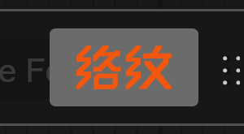

# 络纹 LuoWen

ComfyUI 的连线表达与工作流整理扩展：正交/贝塞尔线路、节点避障、主干合流、流向动效、连线配色、一键自动布局与拖动对齐吸附。

纯前端扩展，不注册任何节点。**默认只读取工作流**——线路怎么画、节点槽点什么颜色，都不改图数据；唯一的写入是用户主动触发的「整理」（一整次一条撤销）与可选的「整理时折叠说明节点」。

## 能力

### 线路

- **三种样式**：`orthogonal`（A* 正交折线）、`smooth`（同骨架的真 Bezier 圆角）、`native`（回归宿主渲染）
- **节点避障**三档净空：低 8 / 标准 16 / 高 24 图 px；求解按严格→半严格→宽松逐级降级，不穿过节点主体
- **绕障外角大斜切**：只切为绕开第三方节点形成的外凸直角，三通/分叉/引脚段保持直角（仅正交样式）
- **圆角半径** 0–24 图 px（默认 10，仅 `smooth`）
- **主干合流**：同一输出端口只出一条线，到合法的最晚分叉点后再分支；分叉后共用走廊
- **输入侧分道**：多引脚按接近方向嵌套排布；同目标等距带按目标引脚 y 排序成带，间距取「兄弟线间距」（默认 12，遇相邻引脚更近时取最小值）
- **拖动对齐吸附**：单节点拖动时与相连邻居的引脚行/矩形对齐，画布上显示提示线

### 动效

- 两种线型：**局部光脉冲**（默认，一段有限亮束沿线路行进）、**虚线行进**
- 三种范围：仅选中（推荐）/ 仅执行中 / 全图（氛围装饰）
- 空闲与无目标时循环自停、零重绘；系统「减少动态效果」时自动改实线，缩放 ≤ 40% 自动关闭
- 「生成时禁用动效」默认开：工作流运行期间暂停，结束自动恢复

### 连线配色

- 五套主题，按 **62 类连线数据类型**着色，均通过对比度（canvas/card ≥ 3:1）与色盲 ΔE 门槛：

  | 主题 | 来源 | 说明 |
  |---|---|---|
  | 夜灯（默认） | ThemeVault #001 erge/dark | 暖棕黑底、低蓝低眩光，暖色主导 |
  | 晨光 | ThemeVault #002 erge/light | 浅底 |
  | 赛博朋克 | 旧 cyberpunk 调色板色相锚 | 高分离度霓虹 |
  | 水母 | ThemeVault #057 | 霓虹粉/黄/青 |
  | 日晒 | ThemeVault #137 | Solarized 色相 |

- **配色范围**可选「连线 + 槽点」或「仅连线」；槽点同步会写入宿主调色板，关闭/切换时还原
- 主题来源与取色口径见 [docs/specs/link-color-tokens/theme-sources.md](docs/specs/link-color-tokens/theme-sources.md)

### 自动布局（整理）

- 入口：画布上方 logo 按钮（可拖动、可隐藏）、画布右键 → 络纹、快捷键
- 全图整理（`Ctrl+Shift+L`）与选区整理（`Ctrl+Alt+L`）；有选中节点时点按钮整理选区，否则整理全图
- ELK Layered 分层布局 + 主链识别 + 端口对齐：未选中节点与固定节点零位移，整理后节点无重叠
- 可选：整理时折叠说明节点、列内对齐、多工作流排布（竖排/横排）、三档间距
- 一次整理 = 一条撤销记录，可整次恢复

### 交互

- 画布右键「络纹」子菜单：整理全图 / 整理选区 / 开启或关闭流行动效 / 切换动效线型（与设置面板同一设置项）
- 设置面板「其他 → LuoWen」：8 组 29 项，中文 / English 跟随宿主或手动指定
- 悬浮说明统一使用主题化提示框，不用原生 title

## 安装

1. 把 `luowen/` 整个目录复制到 ComfyUI 的 `custom_nodes/` 下（目录名任意）
2. 重启 ComfyUI
3. 刷新页面：画布右上出现「络纹」logo 按钮，设置面板「其他」下出现 `LuoWen` 分组

无构建步骤、无 npm 依赖、无第三方 Python 包；服务端入口只有 `WEB_DIRECTORY = "./web"`。

| 项 | 已验证环境 |
|---|---|
| ComfyUI | v0.43.2（Windows portable） |
| 前端（comfyui-frontend-package） | **1.55.18**（宿主 requirements 声明 1.57.4，本仓库按 1.55.18 验证） |
| Python | 3.13（宿主 embedded，仅用于加载 `__init__.py`） |
| 浏览器 | Chromium（Playwright 自动化实测） |

卸载：删除 `custom_nodes/luowen/` 并重启。设置项保存在 ComfyUI 用户设置里，重新安装后沿用。

## 快速上手

| 想做什么 | 怎么做 |
|---|---|
| 整理整张图 | 点 logo 按钮（无选中时）或 `Ctrl+Shift+L` |
| 只整理一部分 | 选中节点后点 logo 按钮或 `Ctrl+Alt+L` |
| 换线路样式 | 设置 → 线路外观 → 线路样式 |
| 换配色 | 设置 → 连线配色 → 主题（默认夜灯） |
| 开关动效 / 换线型 | 画布右键 → 络纹；或设置 → 动效 |
| 让线更容易拉直 | 设置 → 基础 → 吸附距离（2–20 px，默认 20） |
| 隐藏浮动按钮 | 设置 → 自动布局 → 显示「整理」按钮（仍可用右键与快捷键） |

线路样式选 `native` 或关闭总开关，都会完全回到宿主原生绘制。

## 设置总览

分组与顺序按使用频率排：基础 → 线路外观 → 连线配色 → 自动布局 → 动效 → 动效·光束 → 动效·虚线 → 实验。完整说明与提示文案见 [docs/specs/luowen-settings-ui.md](docs/specs/luowen-settings-ui.md)。

| 组 | 设置（默认值） |
|---|---|
| 基础 | 启用络纹（开）、对齐吸附（开）、吸附距离（20 px，2–20 步长 2）、界面语言（跟随宿主） |
| 线路外观 | 线路样式（`orthogonal`）、节点避障（标准）、绕障外角大斜切（开）、圆角半径（10，0–24）、兄弟线间距（12，4–24） |
| 连线配色 | 主题（夜灯）、配色范围（连线 + 槽点） |
| 自动布局 | 多工作流排布（竖排）、整理时列内对齐（自动）、整理时主链水平间距（60）、整理时单进单出节点间距（50）、整理时列内上下间距（40）、整理时折叠说明节点（关）、显示「整理」按钮（开） |
| 动效 | 启用动效（关）、动效模式（仅选中）、动效线型（局部光脉冲）、生成时禁用动效（开） |
| 动效·光束 | 光束·流速（2，0–10）、光束·长度（48，24–120）、光束·间距（240，120–480） |
| 动效·虚线 | 虚线·流速（4，0–10）、虚线·长度（7，0–30）、虚线·间距（13，4–40） |
| 实验 | 离线交叉清理（关） |

设置 id 统一为 `LuoWen.*`；`LuoWen.Enabled` 关闭后完全回归原生。已保存值跨会话保留。

## 调试与验证

浏览器控制台 `window.LuoWen`：

| 接口 | 用途 |
|---|---|
| `status()` | 绘制计数、缓存、主干、等距带、交叉清理等运行状态 |
| `verify()` / `rebase()` | 对比节点与 Link 五元组是否被改动 / 重建基线 |
| `snapDebug()` / `crossDebug()` / `colorDebug()` | 吸附（含当前吸附距离）、交叉清理、配色诊断 |
| `autoLayout(scope, opts)` | 程序化整理，`scope` 为 `full` 或 `selected` |
| `routes()` / `trace()` | 当前路由折线与 trace 快照 |
| `setEnabled()` / `setSnapEnabled()` / `setStyle()` / `setChamfer()` / `setCornerRadius()` | 运行期开关 |
| `setCrossCleanup()` / `crossCleanupNow()` | 离线交叉清理开关与手动触发 |
| `setLanePitch()` / `setTrunkCap()` / `setBevelRatio()` | 调试对照参数（仅内存态，不持久化） |

## 开发与测试

| 场景 | 命令 | 验证状态 |
|---|---|---|
| 单元测试 | `node --test tests/unit/*.test.mjs` | [已运行验证] 2026-11-10，174/174 |
| 启动验证宿主 | `run_nvidia_gpu.bat`（宿主根目录，默认 8188） | [未经运行验证] 宿主由用户启动，本轮以浏览器连 8188 实测 |
| Python 语法自检 | `python_embeded\python.exe -I -m py_compile luowen/__init__.py` | [未经运行验证] 本轮未改 Python 文件 |
| 查节点 schema | `curl http://127.0.0.1:8188/object_info/<类名>` | [未经运行验证] |

- 改前端后刷新页面即可；改 `__init__.py` 需重启 ComfyUI
- `node --test` 在 Windows 上必须用 glob（传目录会 `MODULE_NOT_FOUND`）
- 设置页顺序有独立断言：[tests/unit/settingsOrder.test.mjs](tests/unit/settingsOrder.test.mjs)

## 兼容性与已知限制

- **前端版本**：按 1.55.18 验证；宿主 requirements 声明 1.57.4 但未重装，更新版本未验证
- **节点渲染模式**：拖动对齐吸附只在 Vue 节点拖动模式下生效；经典画布（关闭 Vue 节点）仅做过单轮实测
- **自动布局**：使用仓库内 vendored 的 elkjs（EPL-2.0）；大图整理耗时随节点数增长，属用户主动操作，不在渲染热路径
- **大图性能**：合成 500 节点 / 996 线实测 smooth ≈ 119 ms/帧、ortho ≈ 363 ms/帧（2026-11-09 同页 A/B），未达 60 fps 交互；方法与数据见 [docs/agents/performance.md](docs/agents/performance.md)
- **第三方共存**：与 Cable Management / NKD Reroutes / Zip Ties 等只做了源码级冲突面分析，未做完整运行时矩阵，见 [docs/agents/compatibility-matrix.md](docs/agents/compatibility-matrix.md)
- **离线交叉清理**为实验项，默认关闭；只在交叉对数严格下降且总长增幅 ≤15% 时采纳
- **数据边界**：除「整理」（含可选折叠说明节点）外，其余功能不写工作流数据；`verify()` 可用于自检

## 文档导航

| 文档 | 内容 |
|---|---|
| [docs/prd/luowen-prd-v1.0.md](docs/prd/luowen-prd-v1.0.md) | 产品需求基线：范围、算法方案、验收标准 |
| [docs/routing-algorithm.md](docs/routing-algorithm.md) | 路由算法现状：挂载链路、lane 分配、主干/斜切、等距带、缓存降级 |
| [docs/comfyui-dev-conventions.md](docs/comfyui-dev-conventions.md) | ComfyUI 开发约定与源码级取证（file:line） |
| [docs/specs/auto-layout/](docs/specs/auto-layout/) | 自动布局规格与实测 |
| [docs/specs/link-color-tokens/](docs/specs/link-color-tokens/spec.md) | 连线配色 token、门槛与验收材料 |
| [docs/specs/luowen-settings-ui.md](docs/specs/luowen-settings-ui.md) | 设置面板信息架构、排序机制与验收记录 |
| [docs/agents/performance.md](docs/agents/performance.md) | 性能口径、A/B 数据与热点 |
| [docs/agents/compatibility-matrix.md](docs/agents/compatibility-matrix.md) | 兼容性与第三方冲突面 |
| [GLOSSARY.md](GLOSSARY.md) | 项目术语表 |
| [CHANGELOG.md](CHANGELOG.md) / [CHANGELOG.en.md](CHANGELOG.en.md) | 变更日志（Keep a Changelog） |
| [docs/agents/project-progress.md](docs/agents/project-progress.md) | 当前进度与未完成项（开发过程档案） |

## 许可

MIT，见 [LICENSE](LICENSE)。复用的第三方代码与许可见 [THIRD_PARTY_NOTICES.md](THIRD_PARTY_NOTICES.md)：elkjs（EPL-2.0）、dagre（MIT）、ComfyUI Cable Management（MIT，`geometry/router.js` 与 `geometry/trace.js` 的改编来源）。
